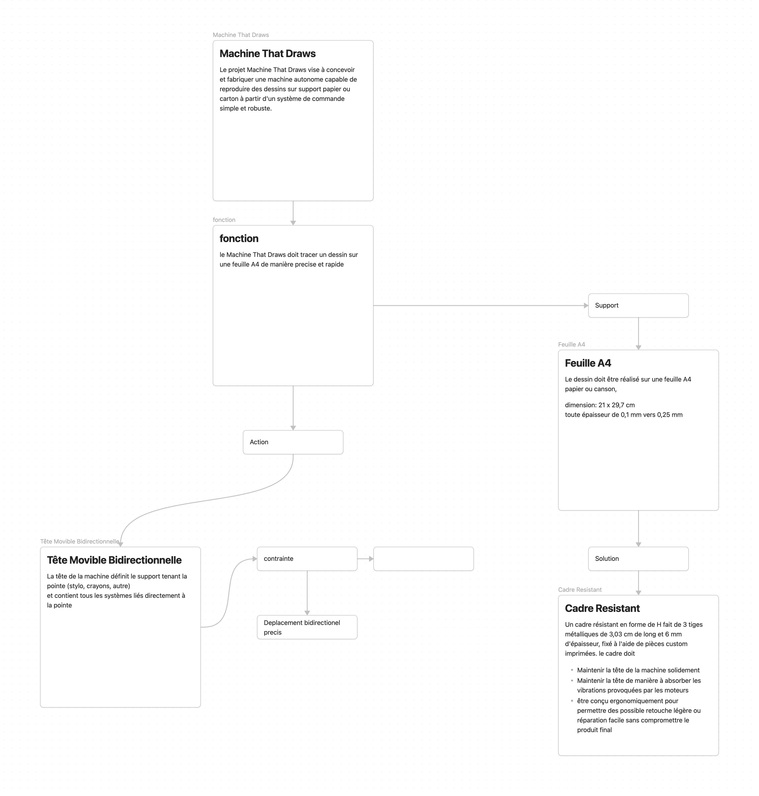

# 2026-11-10 : séance de schematisation

**Séance :** planifiée · **Durée :** 1h30

## Fait

creation d'un schema des fonction de la machine qui dessine 

## Pourquoi

Afin de nous repérer dans la conception de notre projet, nous avons commencé un un schema des fonction de notre machine pour fractioner le projet en etape precise a realiser et ce partager entre nous.

## Reste à faire

finir le schema
